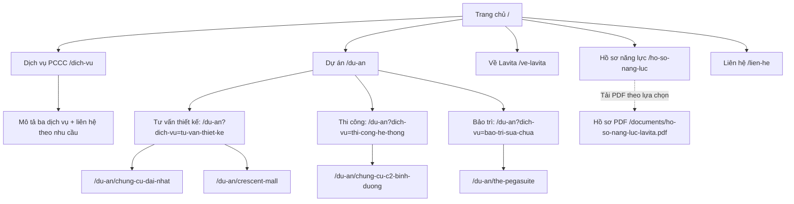
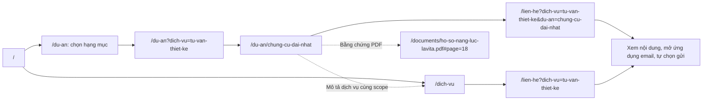

# Kiến trúc thông tin website Lavita

## Phạm vi và quyết định chính

Cập nhật nội dung 16/11/2026: website dùng ảnh/tài liệu và mô tả trực tiếp, không hiển thị dẫn nguồn hồ sơ, số trang hoặc liên kết đối chiếu PDF. Chỉ nút tải tại `/ho-so-nang-luc` nhắc đến PDF. Tham chiếu nguồn trong tài liệu này được giữ cho biên tập nội bộ.

Website có trang mô tả dịch vụ và khu vực dự án riêng. Theo yêu cầu người dùng, **dịch vụ** trình bày công ty phục vụ những gì; luồng **dự án** là **hạng mục dịch vụ → danh sách công trình đúng hạng mục → chi tiết công trình**. Trang chủ vẫn là điểm tổng quan; hồ sơ PDF là nguồn đối chiếu, không thay thế nội dung trên website.

- Website: `https://lavitacons.vn`.
- Ghi nhận ban đầu: **14/10/2026**; cập nhật cấu trúc theo yêu cầu người dùng **13/11/2026**.
- Cấu trúc triển khai: **14 trang HTML**, gồm cả ba URL thông tin dịch vụ chi tiết cũ được giữ để không làm hỏng liên kết; query hạng mục hoặc ngữ cảnh không tạo thêm trang độc lập trong sitemap.
- Nguồn: hồ sơ năng lực Lavita, các cập nhật doanh nghiệp của người dùng và dữ liệu tại `src/data/home.ts`.
- Tình trạng: tài liệu quyết định cấu trúc phục vụ triển khai. Chưa có card sorting, tree testing, nghiên cứu khách hàng hoặc ký duyệt IA riêng.

Hướng dẫn áp dụng là [Information Architecture của RampStack](docs/information-architecture/SKILL.md), cùng template và URL pattern library. Đây là tái cấu trúc website nhiều trang, thuộc phạm vi skill; không dùng skill này để thay thế thiết kế thị giác. Nguồn và bản snapshot xem tại [docs/information-architecture/README.md](docs/information-architecture/README.md).

## Người đọc và nhiệm vụ

Các nhóm dưới đây là **suy luận từ hồ sơ doanh nghiệp và dịch vụ**, chưa được xác nhận bằng phỏng vấn người dùng.

| Nhóm người đọc dự kiến | Điều cần tìm | Điểm vào |
| --- | --- | --- |
| Chủ đầu tư/đơn vị chuẩn bị công trình | Dịch vụ thiết kế, thi công phù hợp giai đoạn công trình | `/dich-vu` |
| Đơn vị quản lý/vận hành công trình | Bảo trì và sửa chữa | `/dich-vu` |
| Người đánh giá năng lực hoặc chuẩn bị lựa chọn đối tác | Phạm vi Lavita thực hiện tại dự án, nguồn PDF, thông tin doanh nghiệp | `/du-an`, `/ve-lavita` |
| Người đã xác định nhu cầu | Điện thoại/email và nội dung cần trao đổi | `/lien-he` |

Nhiệm vụ chính là nhận diện dịch vụ, xem phạm vi thực tế, xem tài liệu và ảnh thực tế, liên hệ đúng ngữ cảnh và quay lại nhóm nội dung liên quan. Header cho phép vào trực tiếp các nhóm này. Luồng xem bằng chứng có thể đi qua nhiều trang; người muốn liên hệ ngay có CTA chung, không phải hoàn tất một chuỗi bắt buộc.

Mô hình tổ chức dựa trên **nhu cầu và giai đoạn công trình**. Các nhóm dịch vụ giúp quét danh mục; phạm vi PCCC là tiêu chí tìm dự án. Tên công trình hoặc cơ cấu nhân sự không trở thành cách chia dịch vụ.

## Kiểm kê nội dung

| Nội dung hiện có | Nguồn và giới hạn | Cách dùng |
| --- | --- | --- |
| Ba dịch vụ PCCC | Tên và mô tả từ dữ liệu doanh nghiệp | Một trang mô tả đầy đủ; URL thông tin chi tiết cũ vẫn hoạt động |
| Bốn dự án đang được giới thiệu | Chỉ là các ví dụ đã chọn từ hồ sơ, không là tổng số công trình Lavita | Danh sách theo hạng mục, bốn trang chi tiết, phạm vi PCCC rõ ràng |
| Giới thiệu, năm thành lập, tầm nhìn, sứ mệnh, giá trị, kế hoạch tăng trưởng | Phần mở đầu hồ sơ, PDF 2–5; dữ liệu `aboutCompany` | `/ve-lavita` chi tiết và phần tổng quan trang chủ; các mốc tăng trưởng là mục tiêu kế hoạch |
| Hotline, email, địa chỉ, mã số thuế | Cập nhật hiện tại trong `company`, giữ số điện thoại và `tel:` đồng bộ | Header, footer, liên hệ và structured data |
| Hồ sơ năng lực | Trang HTML từ dữ liệu doanh nghiệp và hồ sơ gốc | `/ho-so-nang-luc`, có mục lục và nút tải PDF khoảng 67 MB; cần giữ file trên server sau khi clone |
| Gợi ý thông tin chuẩn bị tư vấn | Nội dung hướng dẫn mới để người đọc mô tả nhu cầu | Trang dịch vụ và trình soạn email; không là quy trình pháp lý hoặc cam kết dịch vụ |

Địa chỉ và điện thoại hiện tại lấy từ dữ liệu người dùng cập nhật, không khôi phục thông tin cũ từ PDF. Tham khảo [README](README.md) để bổ sung PDF ngoài Git khi chuyển máy/server.

## Sơ đồ website

`/dich-vu` là trang nội dung mô tả dịch vụ. `/du-an` là trang chọn hạng mục; danh sách theo hạng mục dùng query và trang chi tiết giữ URL công trình hiện có.



“Dịch vụ PCCC” là link tới trang mô tả dịch vụ, không có menu con. Menu “Dự án” chỉ có các hạng mục dịch vụ, không liệt kê công trình; thêm dự án không làm dài menu. Mỗi hạng mục dẫn tới danh sách công trình đúng `serviceSlug`. Slug chi tiết không nhận diện trả trang 404; 404 là trạng thái hệ thống, không là một mục nội dung trong sitemap.

## URL và canonical

| Loại | URL | Canonical |
| --- | --- | --- |
| Trang chủ | `/` | `https://lavitacons.vn/` |
| Mô tả dịch vụ | `/dich-vu`, anchor `#[service-slug]` | `/dich-vu`, không fragment |
| Thông tin dịch vụ bổ sung, giữ URL cũ | `/dich-vu/[slug]` | URL của dịch vụ đó |
| Hạng mục dự án | `/du-an` | URL hub, không query |
| Danh mục sản phẩm | `/san-pham?danh-muc=[slug]&q=[từ khóa]` | `/san-pham`, không query |
| Chi tiết sản phẩm, khi có dữ liệu | `/san-pham/[slug]` | URL sản phẩm đó |
| Chi tiết dự án | `/du-an/[slug]` | URL của dự án đó |
| Doanh nghiệp | `/ve-lavita` | URL trang đó |
| Hồ sơ năng lực | `/ho-so-nang-luc` | URL trang đó |
| Liên hệ | `/lien-he` | URL trang đó, không query |
| Lọc dự án | `/du-an?dich-vu=tu-van-thiet-ke` | `/du-an` trên origin chuẩn |
| Liên hệ theo ngữ cảnh | `/lien-he?dich-vu=bao-tri-sua-chua&du-an=the-pegasuite` | `/lien-he` trên origin chuẩn |
| Nguồn PDF | `/documents/ho-so-nang-luc-lavita.pdf#page=25` | Tệp đối chiếu; fragment chỉ chọn trang PDF |

URL HTML dùng chữ thường, không dấu, dấu gạch nối; không có slash cuối trừ `/`. Nhóm dịch vụ không xuất hiện thêm trong URL chi tiết, để việc đổi cách nhóm không làm đổi slug. Sitemap XML chứa các trang chuẩn, không chứa query, anchor hoặc trang không có nội dung thật. Metadata từng route phải ghi canonical của route đó thay vì kế thừa canonical trang chủ.

Query là trạng thái giao diện: `dich-vu` nhận slug dịch vụ đã biết; `du-an` nhận slug dự án đã biết. Các giá trị không nhận diện hoặc nhiều giá trị cho cùng tham số được bỏ qua an toàn, hiển thị danh sách/luồng chung. Liên hệ vào từ dự án có thể suy ra dịch vụ theo phạm vi của dự án. Người đọc vẫn có thể đổi dịch vụ cần hỏi; dự án tiếp tục được ghi rõ là **tham khảo**, kèm scope thực tế, không được diễn giải thành dịch vụ mới Lavita đã làm tại công trình đó.

Các anchor trang chủ hiện có như `/#services`, `/#projects`, `/#about`, `/#capabilities`, `/#contact` được giữ để liên kết cũ còn sử dụng. Không thể tạo server redirect dựa riêng vào fragment vì fragment không được gửi tới server. Liên kết chính mới dùng route thật; section cũ dẫn tới hub hoặc liên hệ tương ứng. Khi đổi slug đã xuất bản sau này, bổ sung redirect trực tiếp từ URL cũ và cập nhật internal links/sitemap cùng lượt.

## Navigation

Primary nav có sáu mục, theo thứ tự: **Về Lavita**, **Dịch vụ PCCC**, **Dự án**, **Sản phẩm**, **Hồ sơ năng lực**, **Liên hệ**. Logo dẫn về `/`; CTA tư vấn dẫn về `/lien-he` ở mọi trang. Chỉ dự án có menu con theo hạng mục dịch vụ; không đưa danh sách công trình vào header. Sản phẩm có danh mục riêng, không đưa trở lại các dịch vụ đã gỡ.

```text
Desktop: [Logo → /] [Về Lavita] [Dịch vụ] [Dự án theo hạng mục ▾] [Sản phẩm] [Hồ sơ năng lực] [Liên hệ] [Tư vấn công trình]
Mobile:  [Logo → /] [Mở/đóng menu]
Menu:    Về Lavita → Dịch vụ → Dự án (hạng mục dịch vụ) → Sản phẩm → Hồ sơ năng lực → Liên hệ → Gọi hotline
```

Header sticky và nav báo section đang xem, kể cả trên trang chi tiết thuộc section. Menu mobile có trạng thái mở/đóng, Escape và focus về nút mở. Chuyển route phải để người đọc tiếp tục tới nội dung, không giữ menu che trang mới.

Secondary nav gồm breadcrumbs, bộ chuyển hạng mục trên danh sách dự án, dịch vụ liên quan và đường quay lại. Breadcrumb dự án có dạng **Trang chủ → Dự án → Hạng mục dịch vụ → Công trình**; phần hiện tại không phải link, có `BreadcrumbList` schema. Trang chi tiết có đường quay về đúng danh sách hạng mục.

Footer gom liên kết vào **Dịch vụ PCCC** (anchor tới ba mô tả trên cùng trang), **Tìm hiểu Lavita** (dự án, doanh nghiệp, liên hệ, hồ sơ) và thông tin công ty/điện thoại/email/địa chỉ. Không tạo mục privacy, tuyển dụng, tài khoản hoặc tìm kiếm khi chưa có nội dung/chức năng đó.

Nút tải hồ sơ duy nhất ghi “Tải hồ sơ PDF” và dùng thuộc tính `download`; không còn link đối chiếu PDF ở dịch vụ hoặc dự án. Điều hướng route dẫn tới trang nội dung HTML.

Từ 16/11/2026, mục Hồ sơ năng lực và CTA tổng quan dẫn tới `/ho-so-nang-luc` trong cùng tab. Trang áp dụng bố cục ảnh gốc từ PDF: đội ngũ thi công, bản scan pháp lý, bằng cấp/chứng chỉ nhân sự, cây tổ chức và ba cụm dự án theo phạm vi PCCC. Hiện có bốn bản scan pháp lý mở lớn, chuyển ảnh và phóng ngay trên web; phần bằng cấp nhân sự đang ẩn. PDF là nút tải riêng cuối trang; các trang công trình không có link đối chiếu PDF. Không đưa trở lại các dịch vụ đã gỡ hoặc kế hoạch doanh thu.

## Content types và taxonomy

Mục sản phẩm được dựng khung theo yêu cầu người dùng, hiện chưa có hàng thực tế trong dữ liệu. `/san-pham` có bốn nhóm khởi tạo và tìm kiếm; `products` rỗng nên hiển thị đang cập nhật. Không tạo trang chi tiết trong sitemap cho sản phẩm chưa tồn tại. CTA liên hệ giữ nhóm/sản phẩm đã xác thực qua `nhom-san-pham` và `san-pham`. Cấu trúc và cách bổ sung ghi tại [docs/products.md](docs/products.md).

| Content type | Trường chính | Template và liên kết |
| --- | --- | --- |
| Mô tả dịch vụ | Nhãn nhóm, mô tả nhóm, nội dung ba dịch vụ | `/dich-vu`, anchor từng dịch vụ và liên hệ có ngữ cảnh |
| Service | `slug`, `title`, `description`, `group`, `image`, `preparation`, `relatedServiceSlugs` | Mô tả tại `/dich-vu#[slug]`; giữ `/dich-vu/[slug]` cũ, không nhúng danh sách dự án |
| Hạng mục và danh sách dự án | Hạng mục từ `services`, ảnh đại diện từ `projectPortfolio`, công trình khớp `serviceSlug` | `/du-an` chọn từ ba hạng mục có ảnh; query mở danh sách ảnh lớn với các hàng thông tin phạm vi, chọn công trình mở chi tiết |
| Project | `slug`, `serviceSlug`, `title`, `description`, `tag`, `image`, `profilePage` | `/du-an/[slug]`, scope rõ, tham chiếu nguồn nội bộ, liên hệ và hub lọc |
| Trang doanh nghiệp | Giới thiệu, tầm nhìn, năm sứ mệnh, năm giá trị và kế hoạch 2023–2027 | `/ve-lavita`, mục lục bốn phần, dẫn dịch vụ và hồ sơ |
| Trang liên hệ | Thông tin công ty, dịch vụ/dự án tham khảo, nội dung người đọc muốn trao đổi | `/lien-he`, gọi điện hoặc mở email do người đọc tự gửi |

Taxonomy dịch vụ là danh sách nhỏ, có kiểm soát:

| Nhóm | Dịch vụ |
| --- | --- |
| Thiết kế & triển khai (`trien-khai`) | Tư vấn thiết kế; Thi công hệ thống |
| Vận hành & an toàn (`van-hanh`) | Bảo trì & sửa chữa |

Đây là cách nhóm biên tập để tìm nội dung, không là kết quả card sort. Mỗi dự án mẫu đang gắn một `serviceSlug` và một nhãn scope cụ thể; chỉ mở rộng thành nhiều scope khi có bằng chứng cho từng phạm vi. Không thêm tag tự do hoặc taxonomy khách hàng/công trình khi chưa có dữ liệu cần dùng nhất quán.

Nhãn hiện dùng là đề xuất cho triển khai, **chưa được kiểm chứng với khách hàng**. Giữ cách gọi “Dịch vụ PCCC” và “Dự án” (từ 20/11/2026 bỏ chữ “PCCC” sau “Dự án” trên toàn site theo yêu cầu người dùng) ở các phần điều hướng tương ứng; tên dịch vụ/công trình lấy cùng nguồn để không đổi nghĩa giữa menu, breadcrumb, bộ lọc, trang chi tiết và email.

## Cross-links và luồng chính



Hạng mục dẫn tới danh sách, danh sách dẫn tới chi tiết; chi tiết có breadcrumb/đường quay lại đúng hạng mục. Trang dịch vụ mô tả công ty cung cấp những gì và dẫn liên hệ, không là danh sách dự án. Các URL dịch vụ cũ vẫn gợi ý dịch vụ liên quan từ `relatedServiceSlugs`. Dự án cùng phạm vi được chọn bằng `serviceSlug`.

Nguồn đối chiếu cho bốn dự án mẫu: Đại Nhật trang PDF **18**, Crescent Mall **19**, C2 Bình Dương **22**, The Pegasuite **25**. Đây là số trang PDF, không phải số trang in trong tài liệu dạng trang đôi. Nhãn scope phải giữ rõ **Thiết kế**, **Thi công** hoặc **Bảo trì PCCC**; không biến Lavita thành tổng thầu toàn bộ công trình.

## Trạng thái thiếu bằng chứng và phục hồi

Ba hạng mục hiện có đều có công trình được giới thiệu. Nếu bổ sung hạng mục mới chưa có dự án mẫu, trang danh sách cần nói rằng website chưa giới thiệu ví dụ riêng, không suy ra Lavita chưa từng thực hiện dịch vụ. Các dịch vụ được gỡ khỏi dữ liệu website không còn trong menu, liên hệ, sitemap hoặc trang chi tiết; URL tương ứng trả 404.

- Trang dịch vụ mô tả đầy đủ mọi dịch vụ, không hiển thị khối dự án hay trạng thái thiếu dự án.
- Hub dự án lọc một dịch vụ hợp lệ nhưng không có ví dụ: hiển thị trạng thái rỗng, liên hệ theo dịch vụ và quay lại `/du-an`.
- Menu và trang hạng mục có đủ ba dịch vụ, kể cả hạng mục chưa có dự án được giới thiệu. Không tạo kết quả giả để lấp các nhóm còn trống. Query sai hoặc lặp trở về trang chọn hạng mục.
- Unknown detail slug: 404, không thay bằng một dịch vụ/dự án khác.
- Thiếu JavaScript hoặc chưa có ứng dụng email: điện thoại và email trực tiếp là đường tiếp tục. Trang liên hệ chỉ soạn nội dung và mở `mailto:`, không báo đã gửi/lưu yêu cầu tới backend.

Nội dung người đọc nhập không đưa vào URL. Query chỉ giữ các slug không chứa thông tin cá nhân; email preview nêu rõ dịch vụ cần hỏi và dự án đã tham khảo. Không có account, search engine nội bộ, phân trang hoặc infinite scroll trong phạm vi hiện tại: danh mục nhỏ và bộ lọc đủ cho nội dung đang có.

## Ghi chú triển khai và khoảng trống kiểm chứng

Nguồn dữ liệu là `src/data/home.ts`; layout/route và tương tác client tách riêng. Server Components là mặc định; menu, carousel và trình soạn email dùng client component khi cần. Giữ token semantic, font Manrope và nhận diện Lavita theo [DESIGN.md](DESIGN.md).

Metadata/canonical theo từng route, sitemap chỉ gồm các URL chuẩn, breadcrumbs phản ánh hierarchy. Tệp PDF vẫn cần có trên server; thay đổi IA không thêm CMS, backend nhận form hoặc quy trình chứng nhận.

Kiểm tra kỹ thuật cần đi qua route trực tiếp và luồng từ header/hub: mobile/desktop, keyboard, menu, breadcrumbs, liên kết PDF, query, slug không hợp lệ hoặc đã gỡ, email preview và overflow nội dung dài. Kết quả typecheck/build/browser được ghi trong bàn giao thực tế; tài liệu này không tự ghi một tỷ lệ thành công hoặc ký duyệt đã hoàn tất.

Kết quả kiểm tra triển khai ngày 14.10.2026 tại [docs/information-architecture/verification.md](docs/information-architecture/verification.md). Các kiểm tra kỹ thuật này không thay thế nghiên cứu về cách khách hàng tìm và gọi tên nội dung.

Khoảng trống nghiên cứu: cần card sort/tree test hoặc first-click test với người đánh giá đối tác PCCC để kiểm tra cách nhóm và tên gọi. Chưa có mẫu người tham gia, phép đo, nhận xét khách hàng hoặc kết quả nghiên cứu. Các giả thuyết về audience, nhãn nhóm và mức dễ tìm chưa được xác nhận; dữ liệu công ty, slug và mapping dự án là nguồn triển khai đã có.

Khi thêm dịch vụ hoặc dự án: cập nhật dữ liệu, mapping, nguồn bằng chứng, internal links, metadata và sitemap cùng lượt. Giữ slug đã xuất bản; chỉ đổi khi có redirect và nguồn nội dung phù hợp. Không có sign-off IA/nghiên cứu riêng được ghi nhận trong tài liệu này.
