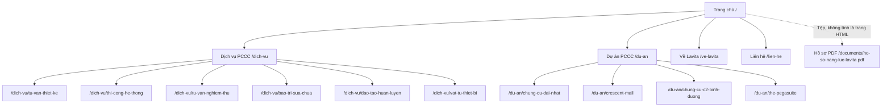
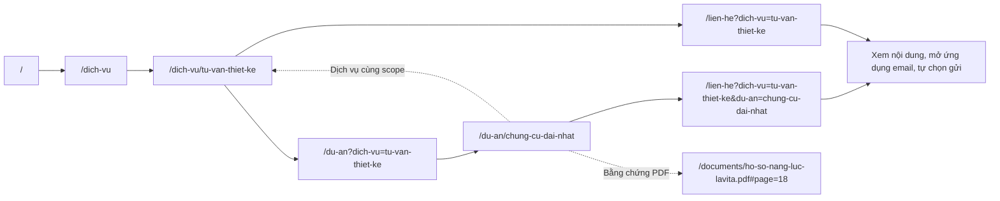

# Kiến trúc thông tin website Lavita

## Phạm vi và quyết định chính

Website chuyển từ trang giới thiệu sang cấu trúc có trang dịch vụ, dự án và liên hệ riêng. Luồng ưu tiên theo yêu cầu người dùng: **tìm dịch vụ → xem công trình cùng phạm vi → trao đổi nhu cầu**. Trang chủ vẫn là điểm tổng quan; hồ sơ PDF là nguồn đối chiếu, không thay thế nội dung trên website.

- Website: `https://lavitacons.vn`.
- Ghi nhận: **14/10/2026**.
- Cấu trúc triển khai: **15 trang HTML** theo danh sách dịch vụ/dự án hiện có; query lọc hoặc ngữ cảnh không tạo thêm trang độc lập.
- Nguồn: hồ sơ năng lực Lavita, các cập nhật doanh nghiệp của người dùng và dữ liệu tại `src/data/home.ts`.
- Tình trạng: tài liệu quyết định cấu trúc phục vụ triển khai. Chưa có card sorting, tree testing, nghiên cứu khách hàng hoặc ký duyệt IA riêng.

Hướng dẫn áp dụng là [Information Architecture của RampStack](docs/information-architecture/SKILL.md), cùng template và URL pattern library. Đây là tái cấu trúc website nhiều trang, thuộc phạm vi skill; không dùng skill này để thay thế thiết kế thị giác. Nguồn và bản snapshot xem tại [docs/information-architecture/README.md](docs/information-architecture/README.md).

## Người đọc và nhiệm vụ

Các nhóm dưới đây là **suy luận từ hồ sơ doanh nghiệp và dịch vụ**, chưa được xác nhận bằng phỏng vấn người dùng.

| Nhóm người đọc dự kiến | Điều cần tìm | Điểm vào |
| --- | --- | --- |
| Chủ đầu tư/đơn vị chuẩn bị công trình | Dịch vụ thiết kế, thi công, tư vấn nghiệm thu phù hợp giai đoạn công trình | `/dich-vu` |
| Đơn vị quản lý/vận hành công trình | Bảo trì, sửa chữa, huấn luyện và thiết bị | `/dich-vu` |
| Người đánh giá năng lực hoặc chuẩn bị lựa chọn đối tác | Phạm vi Lavita thực hiện tại dự án, nguồn PDF, thông tin doanh nghiệp | `/du-an`, `/ve-lavita` |
| Người đã xác định nhu cầu | Điện thoại/email và nội dung cần trao đổi | `/lien-he` |

Nhiệm vụ chính là nhận diện dịch vụ, xem phạm vi thực tế, mở bằng chứng PDF, liên hệ đúng ngữ cảnh và quay lại nhóm nội dung liên quan. Header cho phép vào trực tiếp các nhóm này. Luồng xem bằng chứng có thể đi qua nhiều trang; người muốn liên hệ ngay có CTA chung, không phải hoàn tất một chuỗi bắt buộc.

Mô hình tổ chức dựa trên **nhu cầu và giai đoạn công trình**. Các nhóm dịch vụ giúp quét danh mục; phạm vi PCCC là tiêu chí tìm dự án. Tên công trình hoặc cơ cấu nhân sự không trở thành cách chia dịch vụ.

## Kiểm kê nội dung

| Nội dung hiện có | Nguồn và giới hạn | Cách dùng |
| --- | --- | --- |
| Sáu dịch vụ PCCC | Tên và mô tả từ dữ liệu doanh nghiệp | Một hub và sáu trang chi tiết |
| Bốn dự án đang được giới thiệu | Chỉ là các ví dụ đã chọn từ hồ sơ, không là tổng số công trình Lavita | Một danh sách, bốn trang chi tiết, liên kết trang PDF |
| Giới thiệu, năm thành lập, giá trị, huấn luyện | Nội dung đã có trên website/hồ sơ | `/ve-lavita` và phần tổng quan trang chủ |
| Hotline, email, địa chỉ, mã số thuế | Cập nhật hiện tại trong `company`, giữ số điện thoại và `tel:` đồng bộ | Header, footer, liên hệ và structured data |
| Hồ sơ năng lực | PDF khoảng 67 MB, cần có file trên server sau khi clone | Tệp mở theo lựa chọn, không nhúng tự động |
| Gợi ý thông tin chuẩn bị tư vấn | Nội dung hướng dẫn mới để người đọc mô tả nhu cầu | Trang dịch vụ và trình soạn email; không là quy trình pháp lý hoặc cam kết dịch vụ |

Địa chỉ và điện thoại hiện tại lấy từ dữ liệu người dùng cập nhật, không khôi phục thông tin cũ từ PDF. Tham khảo [README](README.md) để bổ sung PDF ngoài Git khi chuyển máy/server.

## Sơ đồ website

Mô hình chính là **hub-and-spoke**: `/dich-vu` và `/du-an` là hub; chi tiết giữ URL theo hub. Liên kết giữa dịch vụ, dự án và liên hệ tạo các đường đi theo nhu cầu.



Sáu trang dịch vụ và bốn trang dự án nằm ngoài top nav, được tìm qua hub, liên kết liên quan hoặc URL trực tiếp. Slug không nhận diện trả trang 404; 404 là trạng thái hệ thống, không là một mục nội dung trong sitemap.

## URL và canonical

| Loại | URL | Canonical |
| --- | --- | --- |
| Trang chủ | `/` | `https://lavitacons.vn/` |
| Hub dịch vụ | `/dich-vu` | URL hub, không query |
| Chi tiết dịch vụ | `/dich-vu/[slug]` | URL của dịch vụ đó |
| Hub dự án | `/du-an` | URL hub, không query |
| Chi tiết dự án | `/du-an/[slug]` | URL của dự án đó |
| Doanh nghiệp | `/ve-lavita` | URL trang đó |
| Liên hệ | `/lien-he` | URL trang đó, không query |
| Lọc dự án | `/du-an?dich-vu=tu-van-thiet-ke` | `/du-an` trên origin chuẩn |
| Liên hệ theo ngữ cảnh | `/lien-he?dich-vu=bao-tri-sua-chua&du-an=the-pegasuite` | `/lien-he` trên origin chuẩn |
| Nguồn PDF | `/documents/ho-so-nang-luc-lavita.pdf#page=25` | Tệp đối chiếu; fragment chỉ chọn trang PDF |

URL HTML dùng chữ thường, không dấu, dấu gạch nối; không có slash cuối trừ `/`. Nhóm dịch vụ không xuất hiện thêm trong URL chi tiết, để việc đổi cách nhóm không làm đổi slug. Sitemap XML chứa các trang chuẩn, không chứa query, anchor hoặc trang không có nội dung thật. Metadata từng route phải ghi canonical của route đó thay vì kế thừa canonical trang chủ.

Query là trạng thái giao diện: `dich-vu` nhận slug dịch vụ đã biết; `du-an` nhận slug dự án đã biết. Các giá trị không nhận diện hoặc nhiều giá trị cho cùng tham số được bỏ qua an toàn, hiển thị danh sách/luồng chung. Liên hệ vào từ dự án có thể suy ra dịch vụ theo phạm vi của dự án. Người đọc vẫn có thể đổi dịch vụ cần hỏi; dự án tiếp tục được ghi rõ là **tham khảo**, kèm scope thực tế, không được diễn giải thành dịch vụ mới Lavita đã làm tại công trình đó.

Các anchor trang chủ hiện có như `/#services`, `/#projects`, `/#about`, `/#capabilities`, `/#contact` được giữ để liên kết cũ còn sử dụng. Không thể tạo server redirect dựa riêng vào fragment vì fragment không được gửi tới server. Liên kết chính mới dùng route thật; section cũ dẫn tới hub hoặc liên hệ tương ứng. Khi đổi slug đã xuất bản sau này, bổ sung redirect trực tiếp từ URL cũ và cập nhật internal links/sitemap cùng lượt.

## Navigation

Primary nav có năm mục, theo thứ tự: **Dịch vụ PCCC**, **Dự án PCCC**, **Về Lavita**, **Hồ sơ năng lực**, **Liên hệ**. Logo dẫn về `/`; CTA tư vấn dẫn về `/lien-he` ở mọi trang. Ưu tiên dịch vụ và bằng chứng nằm đầu nav; liên hệ cũng có hành động trực tiếp riêng.

```text
Desktop: [Logo → /] [Dịch vụ] [Dự án] [Về Lavita] [Hồ sơ PDF] [Liên hệ] [Tư vấn công trình]
Mobile:  [Logo → /] [Mở/đóng menu]
Menu:    Dịch vụ → Dự án → Về Lavita → Hồ sơ PDF → Liên hệ → Gọi hotline
```

Header sticky và nav báo section đang xem, kể cả trên trang chi tiết thuộc section. Menu mobile có trạng thái mở/đóng, Escape và focus về nút mở. Chuyển route phải để người đọc tiếp tục tới nội dung, không giữ menu che trang mới.

Secondary nav gồm breadcrumbs cho các trang nội dung, bộ lọc theo phạm vi trên `/du-an`, dịch vụ liên quan và đường quay lại hub. Breadcrumbs có dạng **Trang chủ → Dịch vụ PCCC → Dịch vụ đang xem** hoặc **Trang chủ → Dự án PCCC → Công trình đang xem**; phần hiện tại không phải link, có `BreadcrumbList` schema.

Footer gom liên kết vào **Dịch vụ PCCC** (sáu chi tiết), **Tìm hiểu Lavita** (dự án, doanh nghiệp, liên hệ, hồ sơ) và thông tin công ty/điện thoại/email/địa chỉ. Không tạo mục privacy, tuyển dụng, tài khoản hoặc tìm kiếm khi chưa có nội dung/chức năng đó.

PDF dùng link tệp rõ ràng, có nhãn PDF/dung lượng và thông tin mở tab mới. Điều hướng route và download không dùng chung một kiểu đích khiến người đọc nhầm trang nội dung với hồ sơ.

## Content types và taxonomy

| Content type | Trường chính | Template và liên kết |
| --- | --- | --- |
| Hub dịch vụ | Nhãn nhóm, mô tả nhóm, danh sách dịch vụ | `/dich-vu`, dẫn sáu chi tiết và liên hệ chung |
| Service | `slug`, `title`, `description`, `group`, `image`, `preparation`, `relatedServiceSlugs` | `/dich-vu/[slug]`, dẫn dự án cùng scope, PDF và liên hệ có ngữ cảnh |
| Hub dự án | Danh sách dự án, dịch vụ đang lọc | `/du-an`, dẫn chi tiết và phục hồi khi kết quả rỗng |
| Project | `slug`, `serviceSlug`, `title`, `description`, `tag`, `image`, `profilePage` | `/du-an/[slug]`, scope rõ, bằng chứng PDF, liên hệ và hub lọc |
| Trang doanh nghiệp | Giới thiệu, giá trị, năng lực/huấn luyện đã có | `/ve-lavita`, dẫn dịch vụ và hồ sơ |
| Trang liên hệ | Thông tin công ty, dịch vụ/dự án tham khảo, nội dung người đọc muốn trao đổi | `/lien-he`, gọi điện hoặc mở email do người đọc tự gửi |

Taxonomy dịch vụ là danh sách nhỏ, có kiểm soát:

| Nhóm | Dịch vụ |
| --- | --- |
| Thiết kế & triển khai (`trien-khai`) | Tư vấn thiết kế; Thi công hệ thống; Tư vấn nghiệm thu |
| Vận hành & an toàn (`van-hanh`) | Bảo trì & sửa chữa; Đào tạo & huấn luyện |
| Vật tư & thiết bị (`thiet-bi`) | Vật tư & thiết bị |

Đây là cách nhóm biên tập để tìm nội dung, không là kết quả card sort. Mỗi dự án mẫu đang gắn một `serviceSlug` và một nhãn scope cụ thể; chỉ mở rộng thành nhiều scope khi có bằng chứng cho từng phạm vi. Không thêm tag tự do hoặc taxonomy khách hàng/công trình khi chưa có dữ liệu cần dùng nhất quán.

Nhãn hiện dùng là đề xuất cho triển khai, **chưa được kiểm chứng với khách hàng**. Giữ cách gọi “Dịch vụ PCCC” và “Dự án PCCC” ở các phần điều hướng tương ứng; tên dịch vụ/công trình lấy cùng nguồn để không đổi nghĩa giữa menu, breadcrumb, bộ lọc, trang chi tiết và email.

## Cross-links và luồng chính



Hub dẫn tới các chi tiết; chi tiết có breadcrumb/đường quay lại hub. Dịch vụ gợi ý các dịch vụ liên quan từ `relatedServiceSlugs`, không từ danh sách ngẫu nhiên. Dự án cùng phạm vi được chọn bằng `serviceSlug`.

Nguồn đối chiếu cho bốn dự án mẫu: Đại Nhật trang PDF **18**, Crescent Mall **19**, C2 Bình Dương **22**, The Pegasuite **25**. Đây là số trang PDF, không phải số trang in trong tài liệu dạng trang đôi. Nhãn scope phải giữ rõ **Thiết kế**, **Thi công** hoặc **Bảo trì PCCC**; không biến Lavita thành tổng thầu toàn bộ công trình.

## Trạng thái thiếu bằng chứng và phục hồi

Danh sách hiện chưa có dự án mẫu riêng cho **Tư vấn nghiệm thu**, **Đào tạo & huấn luyện**, **Vật tư & thiết bị**. Trang dịch vụ vẫn tồn tại vì dịch vụ có thật trong hồ sơ. Phần dự án cần nói rằng website chưa giới thiệu ví dụ riêng, không suy ra Lavita chưa từng thực hiện dịch vụ.

- Trang dịch vụ chưa có project matching: hướng tới danh mục trong PDF hoặc `/lien-he?dich-vu=[slug]`.
- Hub dự án lọc một dịch vụ hợp lệ nhưng không có ví dụ: hiển thị trạng thái rỗng, liên hệ theo dịch vụ và quay lại `/du-an`.
- Bộ lọc hiển thị thường trực chỉ gồm các scope đang có dự án mẫu. Không tạo kết quả giả để lấp các nhóm còn trống.
- Unknown detail slug: 404, không thay bằng một dịch vụ/dự án khác.
- Thiếu JavaScript hoặc chưa có ứng dụng email: điện thoại và email trực tiếp là đường tiếp tục. Trang liên hệ chỉ soạn nội dung và mở `mailto:`, không báo đã gửi/lưu yêu cầu tới backend.

Nội dung người đọc nhập không đưa vào URL. Query chỉ giữ các slug không chứa thông tin cá nhân; email preview nêu rõ dịch vụ cần hỏi và dự án đã tham khảo. Không có account, search engine nội bộ, phân trang hoặc infinite scroll trong phạm vi hiện tại: danh mục nhỏ và bộ lọc đủ cho nội dung đang có.

## Ghi chú triển khai và khoảng trống kiểm chứng

Nguồn dữ liệu là `src/data/home.ts`; layout/route và tương tác client tách riêng. Server Components là mặc định; menu, carousel và trình soạn email dùng client component khi cần. Giữ token semantic, font Manrope và nhận diện Lavita theo [DESIGN.md](DESIGN.md).

Metadata/canonical theo từng route, sitemap chỉ gồm các URL chuẩn, breadcrumbs phản ánh hierarchy. Tệp PDF vẫn cần có trên server; thay đổi IA không thêm CMS, backend nhận form hoặc quy trình chứng nhận.

Kiểm tra kỹ thuật cần đi qua route trực tiếp và luồng từ header/hub: mobile/desktop, keyboard, menu, breadcrumbs, liên kết PDF, query, slug không hợp lệ, ba nhóm chưa có project, email preview và overflow nội dung dài. Kết quả typecheck/build/browser được ghi trong bàn giao thực tế; tài liệu này không tự ghi một tỷ lệ thành công hoặc ký duyệt đã hoàn tất.

Kết quả kiểm tra triển khai ngày 14.10.2026 tại [docs/information-architecture/verification.md](docs/information-architecture/verification.md). Các kiểm tra kỹ thuật này không thay thế nghiên cứu về cách khách hàng tìm và gọi tên nội dung.

Khoảng trống nghiên cứu: cần card sort/tree test hoặc first-click test với người đánh giá đối tác PCCC để kiểm tra cách nhóm và tên gọi. Chưa có mẫu người tham gia, phép đo, nhận xét khách hàng hoặc kết quả nghiên cứu. Các giả thuyết về audience, nhãn nhóm và mức dễ tìm chưa được xác nhận; dữ liệu công ty, slug và mapping dự án là nguồn triển khai đã có.

Khi thêm dịch vụ hoặc dự án: cập nhật dữ liệu, mapping, nguồn bằng chứng, internal links, metadata và sitemap cùng lượt. Giữ slug đã xuất bản; chỉ đổi khi có redirect và nguồn nội dung phù hợp. Không có sign-off IA/nghiên cứu riêng được ghi nhận trong tài liệu này.
